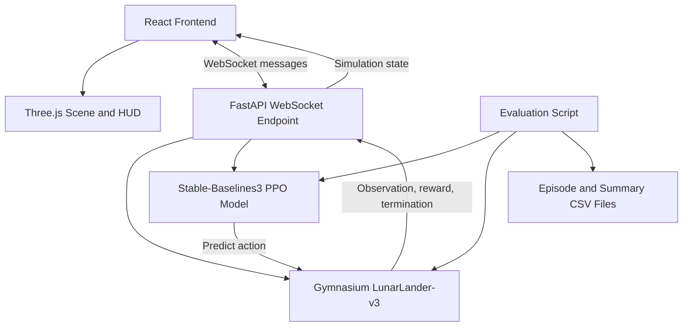

# 🚀 Rocket Landing AI

### A Reinforcement Learning Project for Autonomous Lunar Landing

**Train · Simulate · Visualize · Evaluate**

A reinforcement-learning project that uses Proximal Policy Optimization
(PPO) to control a LunarLander agent, with a custom React + Three.js
interface for visualizing the landing simulation and monitoring agent
telemetry.

[Features](#-features) · [Architecture](#-architecture) · [Tech
Stack](#-technology-stack) · [Setup](#-getting-started) ·
[Evaluation](#-evaluation-and-results)
:::

------------------------------------------------------------------------

## 📸 Frontend Preview

The custom dashboard combines a real-time 3D lunar scene with simulation
controls and telemetry panels.


*Figure 1. Rocket Landing AI dashboard. The scene visualizes the lander
while the side panels display simulation state and agent information.*

> **Screenshot note:** This image documents the frontend appearance.
> Actual values and available controls depend on the running simulation
> and the data exposed by the backend.

## 🎯 Project Overview

Rocket Landing AI explores how a reinforcement-learning agent can learn
to control a lunar lander in the Gymnasium `LunarLander-v3` environment.
The project supports PPO models, including a baseline agent and a
reward-shaped variant, and provides a browser-based 3D visualization for
observing simulation behavior.

The system separates the learning/simulation layer from the presentation
layer:

-   **RL and simulation:** Python, Gymnasium, and Stable-Baselines3.
-   **Visualization and controls:** React and Three.js.
-   **Communication:** FastAPI and WebSockets, where configured, to
    stream simulation observations to the frontend.
-   **Evaluation:** Python evaluation scripts and CSV output for
    episode-level and model-level metrics.

The frontend is a visualization of the environment state. It should not
be treated as a second physics engine or as proof that the policy has
learned a successful landing strategy. Performance should be judged
using repeatable evaluation runs and clearly defined success criteria.

## ✨ Features

-   **PPO-based control:** Load and evaluate trained Stable-Baselines3
    PPO models.
-   **Baseline and reward-shaped comparison:** Select between available
    agents when both model files are present.
-   **3D lunar scene:** Visualize the lander and lunar terrain using
    Three.js.
-   **Live telemetry:** Display available observations such as position,
    altitude, velocity, orientation, step count, and cumulative reward.
-   **Simulation controls:** Start or stop a visualization session when
    supported by the running frontend/backend implementation.
-   **Episode evaluation:** Run multiple episodes using fixed seeds for
    more consistent comparisons.
-   **CSV reporting:** Save episode-level results and model-level
    summary statistics for further analysis.
-   **Separated architecture:** Keep RL training and simulation logic in
    Python while the frontend handles rendering and user interaction.

## 🧱 Architecture



### Component responsibilities

  -----------------------------------------------------------------------
  Component                           Responsibility
  ----------------------------------- -----------------------------------
  **React**                           Builds the dashboard, model
                                      selection, controls, telemetry
                                      panels, and UI state.

  **Three.js**                        Renders the lander, lunar scene,
                                      camera, lighting, and
                                      observation-driven animation.

  **FastAPI**                         Exposes the backend interface used
                                      by the frontend, where implemented.

  **WebSocket**                       Sends simulation state to the
                                      browser without requiring a request
                                      for every frame.

  **Gymnasium**                       Provides the `LunarLander-v3`
                                      environment, observations, rewards,
                                      and episode termination signals.

  **Stable-Baselines3 PPO**           Loads the trained policy and
                                      predicts actions from observations.

  **Evaluation scripts**              Run repeatable episodes and
                                      calculate reward and landing
                                      metrics.

  **CSV results**                     Store episode records and model
                                      summaries for inspection and
                                      plotting.
  -----------------------------------------------------------------------

### Typical simulation flow

1.  The user selects a trained model in the frontend.
2.  The frontend connects to the existing backend interface.
3.  The backend loads the selected PPO model and resets the Gymnasium
    environment.
4.  The policy predicts an action from the current observation.
5.  Gymnasium executes the action and returns the next observation,
    reward, and episode status.
6.  The backend sends the available simulation state to the frontend.
7.  React updates the telemetry and Three.js renders the lander using
    the received state.
8.  At episode completion, the backend reports the final state and the
    frontend displays the available outcome.

**Important:** The exact endpoint, message schema, and available
telemetry must match the implementation in the repository. The diagram
describes the intended architecture; inspect the current source code
before assuming every component or field is present.

## 🛠️ Technology Stack

  -----------------------------------------------------------------------
  Area                    Technology              Purpose
  ----------------------- ----------------------- -----------------------
  Language                Python                  Environment, policy
                                                  inference, training,
                                                  and evaluation

  RL environment          Gymnasium               Landing task and
                          `LunarLander-v3`        environment dynamics

  RL algorithm            Stable-Baselines3 PPO   Policy training and
                                                  action prediction

  API server              FastAPI                 Backend HTTP/WebSocket
                                                  interface, if enabled

  Realtime transport      WebSockets              Streaming simulation
                                                  state to the browser

  Frontend                React                   UI components and
                                                  application state

  3D rendering            Three.js                Lander model, lunar
                                                  scene, camera, and
                                                  lighting

  Frontend tooling        Vite, if configured     Local frontend
                                                  development server and
                                                  build

  Results                 CSV                     Episode records and
                                                  aggregate metrics
  -----------------------------------------------------------------------

Versions should be taken from the project's actual dependency files.
This README intentionally does not invent package versions.

## 📂 Project Structure

The following is a **logical reference structure**, not a claim that
every path already exists in your repository. Keep the actual filenames
in your checkout as the source of truth.

``` text
rocket-landing-ai/
├── src/
│   ├── train_agent.py          # Baseline agent training, if present
│   ├── train_shaped.py         # Reward-shaped training, if present
│   ├── reward_wrapper.py       # Custom reward wrapper, if present
│   ├── compare_models.py       # Model comparison and CSV reporting, if present
│   └── ui_server.py            # FastAPI/WebSocket server, if present
├── models/
│   ├── PPO_LandLunar_v3.zip    # Example baseline model filename
│   └── PPO_time_penalty.zip    # Example reward-shaped model filename
├── frontend/
│   ├── src/
│   │   ├── App.jsx
│   │   └── App.css
│   └── package.json
├── results/
│   ├── episode_results.csv
│   └── model_comparison_summary.csv
├── docs/
│   └── screenshots/
│       └── rocket-landing-dashboard.png
├── README.md
└── pyproject.toml / requirements.txt
```

Some names above are examples based on the current project workflow. Do
not rename existing files to match this diagram; update the
documentation to reflect the repository if its structure differs.

## ⚙️ Getting Started

### Prerequisites

-   Python compatible with the project's pinned dependencies.
-   Node.js and npm for the React frontend.
-   The project's Python dependencies installed.
-   Trained PPO model files, if you want to run inference.
-   A modern browser with WebGL enabled for the Three.js scene.

### 1. Clone the repository

``` bash
git clone <YOUR_GITHUB_REPOSITORY_URL>
cd rocket-landing-ai
```

Replace the placeholder with the actual repository URL.

### 2. Set up the Python environment

Use the dependency manager and dependency file already present in the
repository. For example, if the project uses `uv`:

``` bash
uv sync
```

If the repository instead uses `requirements.txt`, create and activate a
virtual environment, then install the listed dependencies:

``` bash
python -m venv .venv
```

Windows PowerShell:

``` powershell
.\.venv\Scripts\Activate.ps1
python -m pip install -r requirements.txt
```

Do not run both setup methods blindly. Use the one that matches the
project's committed dependency configuration.

### 3. Check the trained models

From the repository root, inspect the available model files:

``` powershell
Get-ChildItem .\models -File
```

The evaluation and frontend configuration must use the exact model
filenames that exist locally. Stable-Baselines3 commonly saves PPO
models with a `.zip` extension.

### 4. Start the backend

If the repository contains `src/ui_server.py` and exposes the WebSocket
endpoint used by the frontend, start it from the repository root:

``` bash
python -m uvicorn src.ui_server:app --reload --port 8000
```

This command is applicable only if that module and `app` object exist.
Use the actual server module and endpoint defined in your project.

### 5. Start the frontend

If the React application is located in `frontend/` and uses npm:

``` bash
cd frontend
npm install
npm run dev
```

Open the local URL printed by Vite, commonly `http://localhost:5173`.

Ensure the frontend's WebSocket URL matches the backend host, port, and
route. If frontend and backend ports differ, configure the URL in the
frontend's existing configuration rather than changing the backend
contract.

## 🧠 Reinforcement Learning Workflow

The project can be organized around this workflow:

1.  **Environment:** Create `LunarLander-v3` with the selected
    environment settings.
2.  **Training:** Train a PPO policy using Stable-Baselines3.
3.  **Checkpointing:** Save the trained model in the `models/`
    directory.
4.  **Inference:** Load the saved policy and use
    `model.predict(observation, deterministic=True)` during evaluation
    or visualization.
5.  **Evaluation:** Run a fixed number of episodes with controlled
    seeds.
6.  **Reporting:** Record final episode rewards and the chosen
    landing-success metric.
7.  **Visualization:** Stream available observations to the frontend and
    render them in Three.js.

### Baseline PPO vs. reward-shaped PPO

-   **Baseline PPO:** The reference policy trained with its configured
    environment rewards.
-   **Reward-shaped PPO:** A policy trained using the project's custom
    reward modification.

Reward shaping changes the learning signal and may influence the
behavior learned by the agent. It does not guarantee better performance.
Compare the policies using the same environment configuration,
evaluation seeds, and success criteria.

## 📊 Evaluation and Results

The model comparison workflow can produce these files when the
evaluation script is configured to write them:

  ----------------------------------------------------------------------------
  File                                     Contents
  ---------------------------------------- -----------------------------------
  `results/episode_results.csv`            One record per model and evaluation
                                           episode, including the final reward
                                           and landing classification.

  `results/model_comparison_summary.csv`   Aggregate metrics per model, such
                                           as mean reward, reward standard
                                           deviation, stable touchdown count,
                                           and success rate.
  ----------------------------------------------------------------------------

### Metrics

-   **Mean episode reward:** Average total environment reward over the
    evaluated episodes.
-   **Reward standard deviation:** Variation in episode rewards; lower
    variability can indicate more consistent returns, but is not
    sufficient on its own to establish better control.
-   **Stable touchdown count:** Number of episodes satisfying the
    project's specified touchdown heuristic.
-   **Success rate:** Successful episodes divided by total evaluated
    episodes.

A custom stable-touchdown heuristic is not necessarily the same as an
official environment success metric. Document its exact conditions and
avoid treating it as an official Gymnasium metric.

### Reproducible comparisons

For a fair comparison:

-   Evaluate both models with the same environment settings.
-   Use the same episode seeds for each model.
-   Use the same number of episodes.
-   Use deterministic predictions when comparing fixed policies, if
    appropriate.
-   Report the actual evaluation results rather than example or
    placeholder metrics.
-   Use more than a small handful of episodes for conclusions about
    performance.

No benchmark numbers are included here because verified evaluation
outputs were not provided for this README.

## 🖥️ Frontend Design

The frontend is intended to make agent behavior easier to inspect during
inference.

### Main interface areas

-   **Agent model selector:** Choose among the available trained PPO
    models.
-   **Simulation configuration:** Configure supported evaluation
    settings exposed by the UI.
-   **3D viewport:** View the lunar surface and lander.
-   **Mission status:** Display episode number, current step, and
    cumulative reward when provided.
-   **Position panel:** Display horizontal position and altitude.
-   **Velocity panel:** Display horizontal and vertical velocity.
-   **Orientation panel:** Display angle and angular velocity.
-   **Leg-contact indicators:** Show contact information if those
    observation values are mapped correctly.
-   **Engine-command indicator:** Show action information only when the
    action-to-label mapping is valid for the selected action space.
-   **Model comparison:** Display measured results when supported by the
    available data.

The interface is a visual explanation layer. Its lander geometry,
lighting, engine effects, and camera are presentation choices; they
should not be confused with the physics model itself.

## 🔧 Troubleshooting

### The frontend cannot connect to the backend

-   Confirm the backend server is running.
-   Check the WebSocket URL in the frontend.
-   Verify the endpoint path and message schema match the backend.
-   Inspect browser developer tools for connection errors.
-   Check that local security software or firewall rules are not
    blocking the connection.

### A model cannot be found

-   List the contents of `models/`.
-   Confirm the configured model path is correct.
-   Check whether the code expects the filename with or without `.zip`.
-   Confirm the model was saved successfully and is compatible with the
    installed Stable-Baselines3 version.

### The Three.js scene is blank

-   Verify that WebGL is enabled in the browser.
-   Inspect the browser console for shader or JavaScript errors.
-   Check camera position, clipping planes, object scale, and lighting.
-   Confirm the renderer canvas is mounted in a container with nonzero
    width and height.

### The lander does not move

-   Verify that observation messages are arriving over the WebSocket.
-   Confirm the frontend reads the correct observation field.
-   Check the observation-to-world coordinate mapping.
-   Ensure the animation loop is running and the renderer is not being
    repeatedly recreated.

### Reward values appear incorrect

-   Sum step rewards once per episode.
-   Append episode results after the episode terminates or truncates,
    not on every step.
-   Ensure summary statistics use one final reward per episode.
-   Confirm reward shaping is applied only where intended during
    training, and evaluation uses the intended environment.

## 🚧 Limitations and Future Improvements

Possible future extensions include:

-   More detailed procedural lander geometry and materials.
-   Camera modes and a trajectory trail based on actual observations.
-   Episode replay and side-by-side model comparison.
-   More extensive evaluation across multiple seeds.
-   Exportable charts and experiment metadata.
-   Improved telemetry history and landing diagnostics.
-   Automated tests for API message validation and evaluation
    bookkeeping.

These are possible enhancements, not claims that every item is already
implemented.

## 🔒 Reproducibility and Project Integrity

-   Keep trained model files and large artifacts out of version control
    when repository policy requires it.
-   Store dependency versions in the appropriate dependency file.
-   Keep backend, training, evaluation, and frontend responsibilities
    clearly separated.
-   Record environment settings and evaluation seeds alongside results.
-   Avoid committing credentials, API keys, local absolute paths, or
    private environment files.

## 🤝 Contributing

1.  Create a feature branch.
2.  Make a focused change.
3.  Test the affected component.
4.  Verify that frontend changes do not unintentionally alter backend
    contracts.
5.  Submit a pull request with a concise description and screenshots
    when UI changes are involved.

## 📄 License

Add the license selected for this repository. Until a license is
committed, do not assume that the project is released under a particular
open-source license.

------------------------------------------------------------------------

